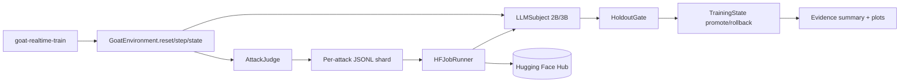

# GOAT-Evolution ⚔️

Per-attack co-evolution training environment for an LLM defender.

The defender LLM (Qwen2.5-3B-Instruct or Gemma-2-2b-it) is the **test subject**. After every red attack inside the OpenEnv-compatible `GoatEnvironment`, the trainer:

1. Captures the attack/response pair via the standard `reset → step → state` loop.
2. Runs a deterministic grader (`AttackJudge`) that produces a chosen-response training pair.
3. Writes a per-attack JSONL shard.
4. Runs an HF-style training job (LoRA on `hf_local`, trainable defense-policy proxy on `stub`).
5. Saves a candidate checkpoint, evaluates a fixed holdout suite, and promotes or rolls back via gates.
6. Optionally pushes the shard + candidate adapter to a Hugging Face dataset/model repo so remote compute (Colab/HF Jobs) can continue training.

The CLI runs Python-first against the env classes and does **not** require the FastAPI/OpenEnv HTTP routes.

## Hackathon alignment

- **Theme**: Self-improvement + multi-agent + long-horizon (red ↔ blue ↔ judge ↔ trainer).
- **OpenEnv (latest)**: `GoatEnvironment` keeps the Gym-style `reset/step/state` contract; `openenv.yaml` declares the Space.
- **Training script**: `training/hf_online_finetune.py` (TRL `SFTTrainer` + PEFT/LoRA) + `training/trl_colab_finetune.ipynb` (Colab-runnable).
- **Reward improvement evidence**: `training/baseline_vs_trained.py` writes `evidence/summary.json` and `evidence/reward_curve.png`.
- **Hosting**: published to a Hugging Face Space; environment + manifest in this repo.
- **Storytelling**: this README links every artifact judges will need.

## Quick start (local, Python-first)

```bash
uv sync
uv run goat-realtime-train --episodes 10 --task-id 4 --subject-size 3b --backend stub
uv run goat-evidence --artifacts-root training/artifacts/realtime
```

Outputs land in `training/artifacts/realtime/`:

| File | Purpose |
|---|---|
| `dataset/shards/atk_*.jsonl` | One JSONL row per attack |
| `dataset/realtime_samples.jsonl` | Append-only master log |
| `attacks.jsonl` | Per-attack record (sample + HF job + gate decision) |
| `episodes.jsonl` | Per-episode summary |
| `reward_curve.csv` | Training-time reward/violation/refusal curve |
| `metrics.json` | Live snapshot of subject + state |
| `baseline_holdout.json` | Holdout metrics before training |
| `training_state.json` | Checkpoint lineage (serving / candidate / last-good) |
| `checkpoints/<label>/` | Subject snapshot per candidate |
| `evidence/summary.json` | Judge-facing baseline-vs-trained summary |
| `evidence/reward_curve.png` | Reward improvement plot |
| `evidence/holdout_compare.png` | Baseline vs trained holdout bars |

## Configurable subject (2B / 3B)

```bash
uv run goat-realtime-train --subject-size 2b --episodes 20    # google/gemma-2-2b-it
uv run goat-realtime-train --subject-size 3b --episodes 20    # Qwen/Qwen2.5-3B-Instruct
```

Backends:

- `--backend stub` (default): no GPU required. Uses the deterministic simulator with a trainable defense-policy proxy that gets per-attack updates. Demonstrates the full loop end-to-end on CPU.
- `--backend hf_local`: loads the real 2B/3B model with PEFT/LoRA and runs an actual gradient step per attack. Requires GPU + the `training` extra (`uv sync --extra training`).

## Push per-attack shards + adapter to Hugging Face

```bash
export HF_TOKEN=hf_xxx
uv run goat-realtime-train \
  --episodes 25 --subject-size 3b --backend stub \
  --push-each-attack \
  --hf-dataset-repo <user>/goat-evolution-attacks \
  --hf-model-repo <user>/goat-evolution-3b-defender
```

Each promoted candidate's adapter directory gets uploaded under `checkpoints/<label>/`.

## Continue training on HF compute (TRL SFT)

```bash
uv sync --extra training
uv run python training/hf_online_finetune.py \
  --dataset-jsonl training/artifacts/realtime/dataset/realtime_samples.jsonl \
  --base-model Qwen/Qwen2.5-3B-Instruct \
  --output-dir training/artifacts/hf-finetuned \
  --only-breaking \
  --push-to-hub --hub-model-id <user>/goat-evolution-3b-defender
```

Or run the Colab notebook: [`training/trl_colab_finetune.ipynb`](training/trl_colab_finetune.ipynb).

## Evidence pipeline

After a training run:

```bash
uv run goat-evidence --artifacts-root training/artifacts/realtime
```

Reads `reward_curve.csv` + `baseline_holdout.json` + `metrics.json`, writes:

- `evidence/summary.json` — first-third vs last-third violation/refusal averages, promotions/rollbacks, totals.
- `evidence/reward_curve.png` — per-attack improvement (matplotlib required).
- `evidence/holdout_compare.png` — baseline-vs-trained bar chart.

## OpenEnv contract (preserved)

`backend/server/goat_environment.py` exposes the Gym-style API:

- `reset(seed, episode_id, task_id, model_profile) -> GOATObservation`
- `step(action) -> (GOATObservation, float, bool, dict)`
- `state -> GOATState`

The trainer injects an `LLMSubject` as the optional `target_subject` constructor arg. The HTTP server (`backend/server/app.py`) still uses the default `TargetModelSimulator` so `openenv.yaml` and the Space deployment are unchanged.

## Architecture



## Layout

```
backend/
  cli/realtime_trainer.py        # Python-first per-attack CLI
  cli/baseline_vs_trained.py     # Console wrapper for the evidence script
  server/goat_environment.py     # OpenEnv-compatible env (target_subject hook)
  training/llm_subject.py        # 2B/3B LLM subject (stub + hf_local)
  training/judge.py              # Per-attack grader -> chosen/rejected
  training/realtime_dataset.py   # Per-attack shard writer + index
  training/hf_job_runner.py      # Per-attack HF training job (local + push)
  training/gating.py             # Holdout suite + promotion gate
  training/state.py              # Persisted checkpoint lineage
training/
  hf_online_finetune.py          # TRL SFTTrainer over realtime shards
  baseline_vs_trained.py         # Reward/holdout evidence generator
  trl_colab_finetune.ipynb       # Colab-runnable training notebook
```

## Validate

```bash
uv run pytest backend/tests
uv run goat-realtime-train --episodes 2 --backend stub --artifacts-root /tmp/goat_smoke
uv run goat-evidence --artifacts-root /tmp/goat_smoke
```
