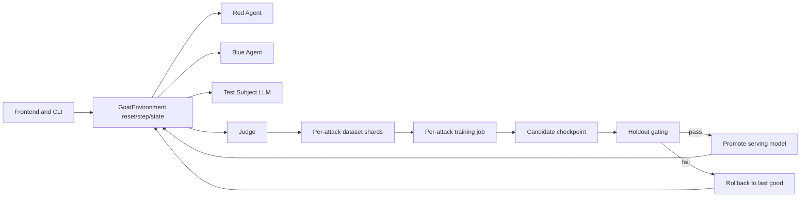

# GOAT-Evolution: How The Whole System Works

## One-line idea

GOAT-Evolution is a continuous safety training system where attacker and defender agents interact in an OpenEnv-compatible environment, the target LLM is evaluated after each attack, and only safe/improving model updates get promoted.

## What problem this solves

Most LLM safety testing is manual, periodic, and shallow. GOAT-Evolution turns this into an always-on loop:

- Generate fresh attack/defense interactions continuously.
- Grade behavior continuously.
- Train continuously from those interactions.
- Promote only when measured safety/quality gates pass.

## System architecture

## Runtime flow (attack to update)

1. Environment starts with `reset`.
2. Red chooses an attack strategy.
3. Subject LLM responds.
4. Blue chooses a defense action.
5. Judge scores the outcome (violation risk, defense success, refusal quality).
6. System writes one training sample for this attack.
7. Training step runs (LoRA/local update).
8. Candidate checkpoint is evaluated on holdout suite.
9. Candidate is promoted or rolled back.
10. Loop continues with harder/fresher attacks.

## What is dynamic vs fixed

- Dynamic:
  - Red/Blue behavior when LLM providers are enabled.
  - Judge outputs and reasoning per attack.
  - Per-attack training samples and checkpoint lineage.
  - Promotion/rollback decisions based on measured metrics.
- Controlled/fixed:
  - Holdout gate thresholds and promotion policy.
  - Environment contract (`reset`, `step`, `state`) for reproducibility.

## What this improves in the model

The system is designed to improve the model in ways that matter for real safety:

- **Lower attack success rate** against evolving jailbreak strategies.
- **Higher refusal quality** for harmful requests.
- **Better robustness over long horizons** (multi-turn sessions, delayed effects).
- **Faster adaptation** via per-attack updates instead of occasional retrains.
- **Safer deployment lifecycle** with explicit promotion gates and rollback.

## Why this aligns with OpenEnv hackathon themes

- Multi-agent interactions: red vs blue co-evolution.
- Long-horizon planning: multi-turn, stateful episodes.
- World modeling: actions alter environment state and future rewards.
- Self-improvement: curriculum emerges from discovered attacks and gating feedback.

## Evidence produced by the system

The project generates concrete artifacts for verification:

- Per-attack datasets (`dataset/shards/*.jsonl`).
- Episode and attack logs (`episodes.jsonl`, `attacks.jsonl`).
- Reward/improvement curves (`reward_curve.csv`, evidence plots).
- Checkpoint lineage (`training_state.json`).
- Component-level runtime logs (`logs/<run>/...`).

## What this contributes to the world

This project is not just a benchmark; it is an operational safety workflow. It contributes:

- A practical pattern for **continuous adversarial training** of LLMs.
- A transparent promotion model for **safer model releases**.
- Reproducible artifacts that support **scientific validation**.
- OpenEnv-compatible interfaces that support **interoperability and reuse**.

## Project commitments

GOAT-Evolution commits to:

- Measuring safety improvement with explicit metrics, not claims.
- Keeping training loops reproducible and inspectable.
- Preserving OpenEnv compatibility (`reset`, `step`, `state`).
- Favoring gated promotion over unsafe automatic deployment.
- Providing clear public evidence (plots, logs, checkpoints, docs).

## Practical summary

If an attack can break the model, GOAT-Evolution captures it, learns from it, validates improvement, and only then updates what serves in production.
